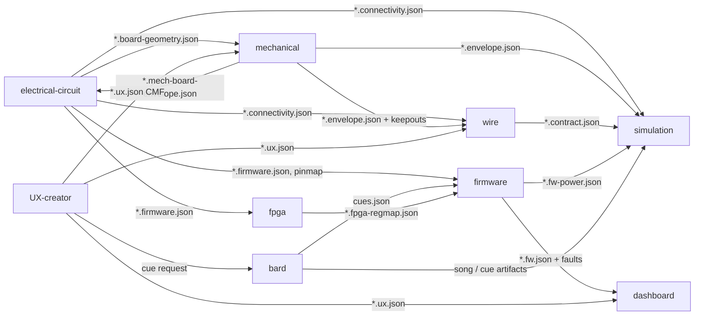
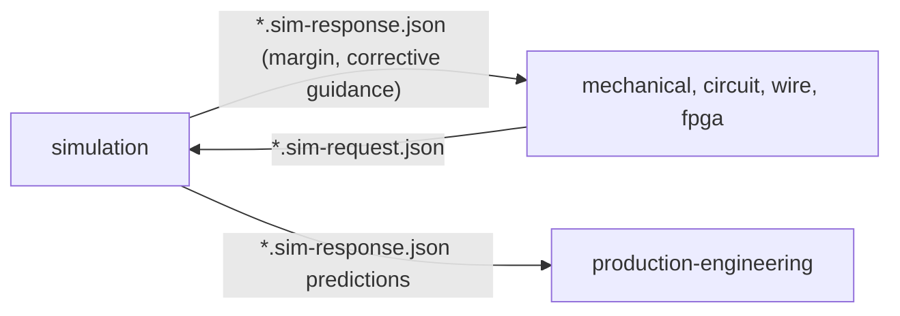
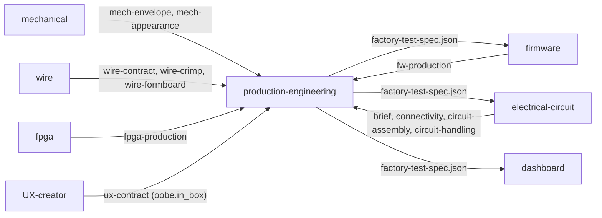
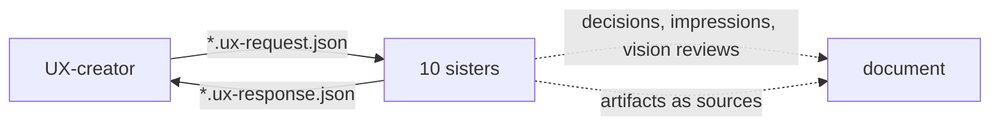

# Agent handoffs in the VibeBB family

[English](#english) | [日本語](#日本語)

## English

This page is the map of artifacts that actually flow between the eleven
VibeBB agents today. Every arrow is backed by code on the `main` branch of
the receiving repository: an import kind, a liaison file, or a contract
field. Planned handoffs are listed separately and move into the map only
when their code lands.

### Rules every handoff follows

- **Artifacts, not imports.** Sisters exchange JSON files in the shared
  workspace. No agent imports another agent's code or edits another
  agent's inputs; a change goes back as a request.
- **Pinned by hash.** The receiver records the producer artifact's
  `sha256`. A changed upstream file is detected, never silently reused.
- **Provenance travels beside the artifact.** A generated export carries an
  interchange envelope v3 sidecar; see [Provenance](#provenance-interchange-envelope-v3).
- **Gates decide.** Only the receiver's deterministic gates issue a
  verdict. Impressions, vision reviews and songs travel with the artifact
  as advisory evidence and never change a verdict.
- **Unknown fails closed.** A missing, unparseable or stale input makes
  the dependent gate `unknown`, which fails the design verdict.
- **Nothing waits.** Records reference only records that already exist;
  no agent blocks waiting for a sister. Missing input is recorded as
  unresolved and work continues (VRP, below).

### Design artifacts

| From | To | Artifact | Where the receiver binds it |
| --- | --- | --- | --- |
| circuit | firmware, fpga | `*.firmware.json` (pins, buses, clocks) | firmware / fpga contract import |
| circuit | wire, sim | `*.connectivity.json` (nets, connector pins) | wire `imports`, sim `ImportRef.system` |
| circuit | mechanical | `*.board-geometry.json` (outline, holes, part heights) | mech `board_geometry` gate |
| mechanical | circuit | `*.mech-board-envelope.json` (height limits, side openings) | circuit `circuit.enclosure` gate |
| mechanical | wire, sim | `*.envelope.json` (fixing points, 3D keep-out boxes) | wire `imports` + `route_keepout` gate, sim `ImportRef.system` |
| wire | sim | `*.contract.json` | sim `ImportRef.system` |
| firmware | sim | `*.fw-power.json` (supply-net draw) | sim `import:firmware:<net>` PDN load |
| bard | sim | song and cue artifacts | sim `ImportRef.system` |
| bard | firmware | `cues.json` playback table | firmware `fw_cues.h` generation |
| fpga | firmware | `*.fpga-regmap.json` | firmware `fw.fpga_regmap` gate |
| firmware | dashboard | `*.fw.json` with `firmware_sha256`, fault table | dashboard `firmware_contract`, `service.faults` gate |
| UX | dashboard, wire | `*.ux.json` | contract import |
| UX | mechanical | `*.ux.json` CMF part | mech `appearance_cmf` gate |

### Simulation requests and answers

| From | To | Artifact | Where the receiver binds it |
| --- | --- | --- | --- |
| mechanical | simulation | drop, vibration and IP study request | sim ruggedness analysis |
| circuit | simulation | per-part dissipation, electrolytic lifetime | sim thermal and Arrhenius analyses |
| wire | simulation | supply loops (PDN) | sim PDN analysis |
| fpga | simulation | package thermal facts | sim thermal analysis |
| simulation | requester | hash-pinned response with margins and corrective guidance on failure | each requester's sim-response gate |
| simulation | production-engineering | predicted characteristic values | prodeng `sim.prediction` gate |

A failing simulation answer goes straight back to the requesting agent as a
change driver; it does not route through UX-creator.

### Manufacturing

| From | To | Artifact | Where the receiver binds it |
| --- | --- | --- | --- |
| circuit, mechanical, wire, UX | production-engineering | brief, connectivity, envelope, contracts | prodeng `ImportRef.kind` |
| circuit | production-engineering | `*.circuit-assembly.json` (per-side SMT/THT), `*.circuit-handling.json` (MSL, reflow peak, ESD) | prodeng `circuit.assembly`, `circuit.handling` gates |
| mechanical | production-engineering | `*.mech-appearance.json` (cosmetic criteria, limit samples) | prodeng `appearance.limit_samples` gate |
| wire | production-engineering | `*.wire-crimp.json`, `*.wire-formboard.json` | prodeng `wire.crimp`, `wire.formboard` gates |
| fpga, firmware | production-engineering | `*.fpga-production.json`, `*.fw-production.json` (gated image sha256, loader options) | prodeng `fpga.programming`, `firmware.programming` gates |
| UX | production-engineering | `oobe.in_box` in the UX contract | prodeng `packaging.oobe` gate |
| production-engineering | firmware | `factory-test-spec.json` | firmware `fw.ftm` gate |
| production-engineering | circuit | `factory-test-spec.json` test nets | circuit `circuit.dft` gate |
| production-engineering | dashboard | `factory-test-spec.json` | dashboard `factory.spec` gate and factory-test panel |

Checks that stay inside one agent (circuit derating, second sources and
fabrication stackup; fpga corner guard band and power estimate) are gates,
not handoffs, and are not drawn here.

### Coordination: liaison (SLP v2) and records (VRP)

- **Sister Liaison Protocol (SLP v2).** UX-creator writes requests into
  each sister's `liaison/` inbox; the sister answers with a response file
  that its guard hook protects. UX-creator detects circular request
  chains, so a request cannot bounce forever. See
  [liaison-protocol.md](liaison-protocol.md).
- **VibeBB Record Protocol (VRP v2).** Each agent appends hash-chained
  decisions, stage impressions, vision reviews, read receipts, insight
  status, blind-review reconciles and bard song receipts to
  `observations/<agent>/*.jsonl`. A reader must answer a sister impression
  it read, a disputed concern cannot be raised again on unchanged bytes,
  and UX-creator's family hub shows concerns that cycle between agents.
  The Stop hook refuses to end a session that owes a record at most twice,
  then allows the stop and records what was missing. See
  [records-protocol.md](records-protocol.md).
- **document** reads sister agents, their artifacts and their records as
  typed sources for reports and launch material.

### Provenance (interchange envelope v3)

Every generated sister export has a sidecar `<artifact>.provenance.json`
next to it (`x.wire-crimp.json` -> `x.wire-crimp.provenance.json`). The
sidecar sits beside the artifact, not inside it, because receivers reject
unknown fields in an artifact body; producers and receivers therefore never
have to merge in lockstep. Each agent ships a byte copy of the same
`_envelope.py` module.

| Field | Rule |
| --- | --- |
| `envelope_version` | `3` |
| `producer` | the writing agent (`circuit`, `mech`, `wire`, `fpga`, `firmware`, `prodeng`, `sim`, `bard`) |
| `artifact` | `{name, sha256}` of the artifact file |
| `sources[]` | `{path, sha256}` of each file the artifact was projected from; workspace-relative when inside the workspace |
| `decision_refs[]` | ids of the producer's VRP decisions whose evidence cites a source at its current sha256 |

The producer refuses to write the sidecar, and removes a stale one, while its
own decision log has a broken hash chain. The JSON is deterministic.

The receiver checks a pinned artifact against its sidecar:

- **pass**: the sidecar names the expected producer and artifact, the
  artifact sha256 equals the pinned sha256, every source still hashes to its
  recorded sha256, and every `decision_refs` id is in the producer's intact
  `observations/<producer>/decisions.jsonl`.
- **fail**: malformed sidecar, wrong version or producer, artifact or source
  mismatch, a ref missing from the log, or a broken producer chain.
- **unknown**: no sidecar, an unreadable source, or refs given while the
  producer log is absent. Binary gates (fpga, firmware, dashboard) turn this
  into a fail that names the unknown status in its detail.

Receivers that pin a specific export always require the sidecar (for
example wire `import_provenance`, mech and circuit `import_provenance`,
fpga `fpga.import_provenance`, firmware `fw.circuit_provenance`, prodeng
`imports.provenance`, sim imports, and the `provenance` finding on every
`*.sim-response.json` read by circuit, mech, wire and fpga). The generic
`imports[]` of UX-creator and dashboard also take authored sister contracts,
which have no sidecar; they check provenance only when a sidecar exists.

### Change control (ECR / ECO)

A sister that must change a file other agents pin by sha256 does not
re-pin silently. It writes an engineering change request (`*.ecr.json`)
and order (`*.eco.json`); UX-creator's `ux change` / `ux_change_check`
finds every consumer pin, rejects stale pins and omitted consumers, and
requires passing gate evidence and dispositioned AI review findings. AI
findings can block a change but never pass one. There is no human
approval step.

### Planned handoffs

None. Every handoff from the previous plan is on `main` and drawn above.
Inputs that enter VibeBB from outside (supplier data, field returns,
regulatory updates) are out of scope for this map.

## 日本語

このページは、11のVibeBB agentの間で、今実際に流れている成果物の地図です。
矢印はすべて、受け取る側のrepositoryの `main` にあるコード（取り込みの種類、
liaisonのファイル、contractの欄）で確かめたものです。計画中の受け渡しは別の
表に分けてあり、コードがmergeされた時点で図に移します。

### すべての受け渡しが守る決まり

- **コードではなく成果物で渡す**: 姉妹agentは、共有workspaceのJSONファイルを
  やり取りします。他のagentのコードをimportしたり、入力を書き換えたりはしません。
  変更が必要な時は依頼として返します。
- **hashで固定する**: 受け取る側は、作成側の成果物の `sha256` を記録します。
  元のファイルが変われば検出され、黙って使い回されることはありません。
- **出どころは成果物の横に置く**: 作られた成果物には、横に別ファイル
  `<成果物>.provenance.json`（interchange envelope v3）が付きます。
- **判定はゲートだけが行う**: 判定を出すのは、受け取る側の決定論ゲートだけです。
  impression、vision review、うたは参考情報として成果物と一緒に渡り、判定を
  変えることはありません。
- **不明は不合格として扱う**: 入力が無い、読めない、古い場合、その入力を使う
  ゲートは `unknown` になり、設計の判定は不合格になります。
- **待たない**: 記録が参照するのは、すでに存在する記録だけです。姉妹の返事を
  待って止まるagentはありません。足りない入力は未解決として記録し、作業を
  続けます。

図と表は英語の節を見てください。agentの間の記録（VRP v2）の決まりは
[records-protocol.md](records-protocol.md)にあります。以前「計画中」だった
受け渡しは、すべて `main` に入り、図と表に移しました。シミュレーションの不合格の
答えは、UXを通さずに依頼したagentへ直接戻ります。他のagentがsha256で固定して
いるファイルを変える時は、ECR/ECOを通します（人による承認はありません）。
外部からVibeBBに入る情報は、この地図の対象外です。

### 出どころの別ファイル（interchange envelope v3）

作る側は、姉妹に渡す成果物の横に `<成果物>.provenance.json` を書きます（例: `x.wire-crimp.json` の横に
`x.wire-crimp.provenance.json`）。成果物の中に入れないのは、受け取る側が知らない項目を拒否するためです。
別ファイルにすれば、作る側と受け取る側を同時にmergeする必要がありません。

- 中身: `envelope_version`（`3`）、`producer`（作ったagent）、`artifact`（成果物の名前とsha256）、
  `sources[]`（元のファイルのパスとsha256）、`decision_refs[]`（元のファイルを今のsha256で根拠に
  挙げている、作る側のVRPの決定のid）
- 作る側は、自分の決定のログの鎖が壊れている間は、別ファイルを書きません（古い別ファイルは消します）。
- 受け取る側は、固定したsha256と別ファイルを照合します。
  - 合格: 作ったagentと成果物の名前が合い、sha256が固定した値と同じで、元のファイルも変わっておらず、
    `decision_refs` がすべて作る側の壊れていないログにある
  - 不合格: 別ファイルが壊れている、版や作ったagentが違う、成果物や元のファイルが変わった、
    ログに無いidがある、作る側のログの鎖が壊れている
  - 不明: 別ファイルが無い、元のファイルが読めない、idがあるのに作る側のログが無い。
    合格か不合格の2値のゲート（fpga、firmware、dashboard）では、理由に「不明」を書いた不合格にします。
- 特定の成果物を固定して取り込む側は、必ず別ファイルを求めます。UX-creatorとdashboardの
  汎用の取り込み（`imports[]`）は、人やagentが書いたcontractも取り込みます。こうしたcontractには
  別ファイルが無いため、別ファイルがある時だけ照合します。
